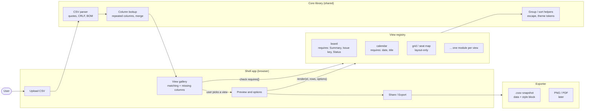
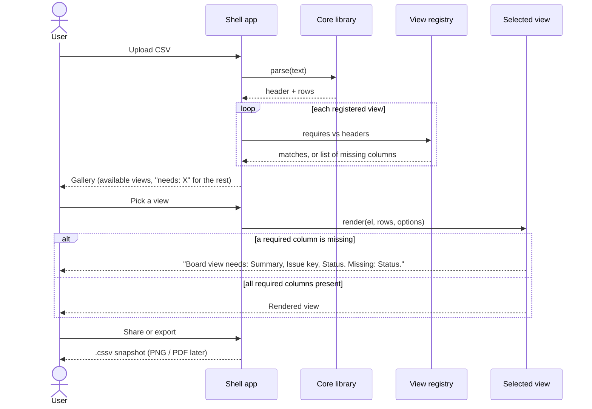

# Vizify: Architecture Design

## 1. Summary

Vizify lets a non-technical user upload a CSV, pick a view (board, calendar, chat, ...), and see their data in that view. If the file lacks columns the view needs, Vizify says which ones.

This document compares two ways to implement views and recommends one. It is based on a review of the CSSV project (spec and reference renderer, `cssv/`) and on a prototype that builds the same Jira board view both ways.

## 2. Goals and non-goals

**Goals**
- Upload a CSV, pick a view, see the result, with no CSS, YAML or code from the user.
- Tell the user clearly which columns a view requires and which are missing.
- Make adding a new view a small, repeatable task.
- Allow sharing or exporting a result.

**Non-goals (v1)**
- Automatic column mapping or renaming. The user supplies the expected column names.
- Letting end users author their own views.
- Editing data in place.

## 3. Background: how CSSV works

CSSV ("Comma-Separated Styled Values") keeps data and look in one text file: an optional CSS style block between `---` fences, followed by CSV.

```
---
@import url("board.css");
table { --cssv-key: Status; }
---
Summary,Status,...
```

The renderer (`<cssv-table>`) builds a fixed HTML table (`table > colgroup, thead, tbody`, with `data-col` on cells and `data-key` on rows), applies the file's CSS in a shadow DOM, and reads two custom properties, `--cssv-key` and `--cssv-format`. CSSV has no per-format code: the Jira board, git log, chat and seat map examples are all CSS written against column names.

CSSV already contains the mechanism for a views feature (`@import` of a shared stylesheet). It lacks the product around it: an upload flow, a view gallery and a column check.

## 4. Options considered

### Option A: CSS views (CSSV as the engine)

Each view is a stylesheet that expects named columns. Vizify checks the headers, then prepends `@import url("views/<view>.css")` to the user's CSV.

### Option B: Component views

Each view is a code module that receives parsed rows and renders HTML:

```js
export const board = { requires: ['Summary', 'Issue key', 'Status'], render };
```

### Option C: Declarative view spec (roles and generic operators)

Front matter declares column roles and layout operators (`group`, `sort`, `place`, `merge`) and the renderer interprets them. Considered and set aside for v1: it needs a larger spec and an operator vocabulary that only an audit of the existing examples could justify, and the requirement to ask users for the right columns removes most of what it was meant to solve.

## 5. Prototype results

The Jira board view was built both ways (A and B) and run in headless Chrome on the same data. Files are in `scratchpad/cmp/` (`compare.html`, `board.js`, `out.png`).

| Case | A: CSS view | B: Component view |
| --- | --- | --- |
| Original Jira export | Correct | Correct, with lane counts |
| New status "Blocked" | No lane created; card silently lands in the In Progress lane (wrong board, no warning) | A fifth lane is created automatically |
| `Status` column renamed `State` | Renders broken (lanes lost, status text leaks into cards) with no error | Clear message: "Board view needs columns: Summary, Issue key, Status. Missing: Status." |
| Repeated `Labels` columns | Styled each, cannot be merged | Merged into one list in one line |
| Size | 53 lines of CSS | 43 lines of JS (plus about 15 lines of unpolished styling) |

Caveats: one view and one dataset, and the component's styling was a quick pass, so the CSS version looks more polished. Nothing here yet shows how the approaches compare on layout-only views such as a seat map or periodic table.

## 6. Comparison

| Concern | A: CSS views | B: Component views |
| --- | --- | --- |
| Portable single file carrying its look | Yes | No (needs the module) |
| Dynamic structure (lanes from data) | No, hardcoded selectors | Yes |
| Column validation and messages | No | Yes |
| Merge, group, compute | No | Yes |
| Interaction (sort, filter, search) | No (static) | Possible |
| Large data | Builds the whole DOM; about 467 ms for 5,000 rows per the CSSV README | Can virtualize |
| Who can write a view | Anyone who knows CSS | A developer |
| Isolation and security | Shadow DOM, with the CSSV remote-load caveats (SPEC §11.2) | Same page, so output must be escaped (done in prototype) |

## 7. Decision

Use **component views (Option B)** as the engine for the upload-and-pick product, with **CSSV as the export and share format** rather than the rendering engine.

Reasons:
- The product's value (upload, pick, see) doesn't use CSSV's main strength, which is a file that carries its own look.
- Its main weaknesses (static output, hardcoded structure, no data logic, silent failure on bad columns) all appear in this flow.
- The required-columns check, central to the UX, is a few lines of code in B and not possible in A.

Layout-only views may still be CSS views (see 8.3). This is a design judgement based on one prototype and should be revisited after the second view (section 11).

## 8. Proposed architecture



### 8.1 Components

1. **Shell app.** Upload, view gallery, preview, share. Can build on the existing CSSV site's live editor and viewer.
2. **Core library (shared).** CSV parsing (quotes, CRLF, BOM), column lookup including repeated columns, grouping and sorting helpers, HTML escaping, theming tokens.
3. **View registry.** A list of view modules, each of the shape:

   ```js
   {
     id: 'board',
     name: 'Board',
     requires: ['Summary', 'Issue key', 'Status'],   // errors if missing
     optional: ['Assignee', 'Labels', 'Custom field (Story Points)'],
     render(el, rows, options) { ... }
   }
   ```
4. **Exporter.** Writes a `.cssv` snapshot (data plus a style block) and, later, PNG or PDF.

### 8.2 Flow



1. Parse the upload and read the header row.
2. For every registered view, compare `requires` with the headers. Show views that match, and for the rest show what is missing (for example "Board needs: Status").
3. When the user picks a view, call `render`. If a required column is missing at this point, show the same message the gallery gave.
4. The user may adjust simple options (sort, theme). Options are view parameters, not CSS.

### 8.3 View types

| Type | Examples | Implementation |
| --- | --- | --- |
| Logic-heavy | Board, calendar, timeline, charts | Component module |
| Layout-only | Seat map, periodic table | CSS view, or one generic grid component taking x and y columns |
| Bespoke | Orrery, visualizer | Stay as CSSV files, outside the gallery |

This split is an expectation, not a verified classification of the existing examples.

### 8.4 Security

- All cell values are inserted as escaped text, never parsed as HTML (the prototype uses an `esc()` helper). This mirrors CSSV's SPEC §7.4 rule.
- User-supplied CSS is not accepted in v1, which avoids the remote-load and selector-leak issues in CSSV SPEC §11.
- Uploaded data stays in the browser for rendering. Whether a server stores it is a separate decision (open question 3).

## 9. Risks

| Risk | Mitigation |
| --- | --- |
| Users cannot rename columns | Show the exact missing names and an example header. Add dropdown column mapping as a v2 step if users get stuck. |
| Every view is hand-built | Keep views small by moving common logic into the core library. Review the view count against demand. |
| Messy exports (merged headers, total rows, odd encodings) | A cleanup step in the shell. Likely larger than expected. |
| Views hardcode one vendor's column names (the prototype does) | Parameterize column names per view, with vendor presets such as "Jira". |
| Component output looks worse than polished CSSV examples | Share one theming layer across views. |

## 10. Alternatives and extensions kept for later

- **Column mapping UI** (dropdowns pre-filled with guesses), if the required-columns rule proves too strict.
- **Declarative view spec** (Option C), if the number of views grows and the same layout operators recur.
- **LLM-authored views**, drafting a view module or stylesheet from a description.

## 11. Open questions and next steps

1. Build a second view both ways (a seat map or calendar) to test whether B's advantage holds beyond the Jira case.
2. Audit the examples in `cssv/examples/` and classify each as logic-heavy, layout-only or bespoke.
3. Decide whether uploaded data is processed only in the browser or stored server-side.
4. Decide whether Vizify depends on the CSSV renderer (for layout-only views and export) or only emits `.cssv`.
5. Choose the first set of views for v1.

## 12. References

- CSSV spec: `cssv/SPEC.md` (file structure §3, table model §7, rendering §8, properties §9, security §11)
- CSSV README: `cssv/README.md`
- Prototype: `scratchpad/cmp/` (`board.js`, `compare.html`, `out.png`), under the session scratchpad
- Jira CSSV example: `cssv/examples/jira-export.cssv`
